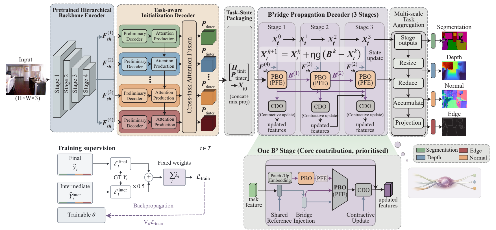
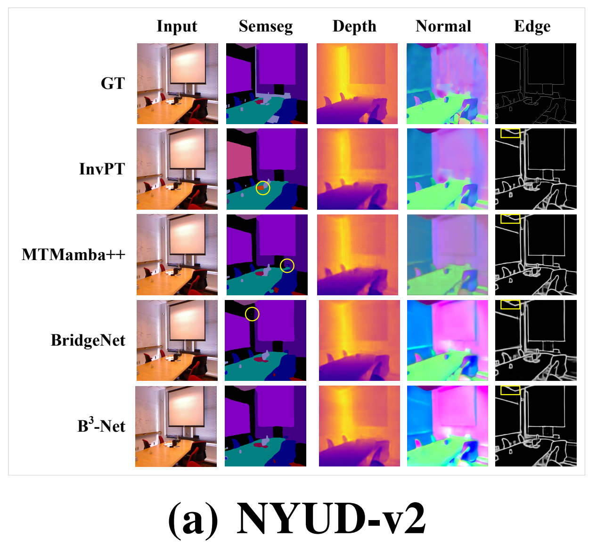
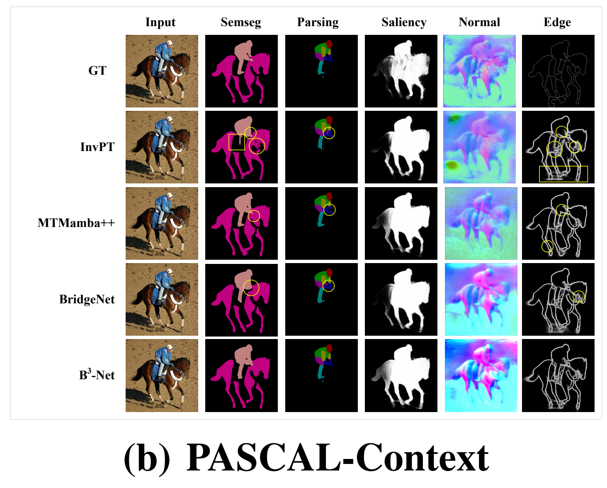
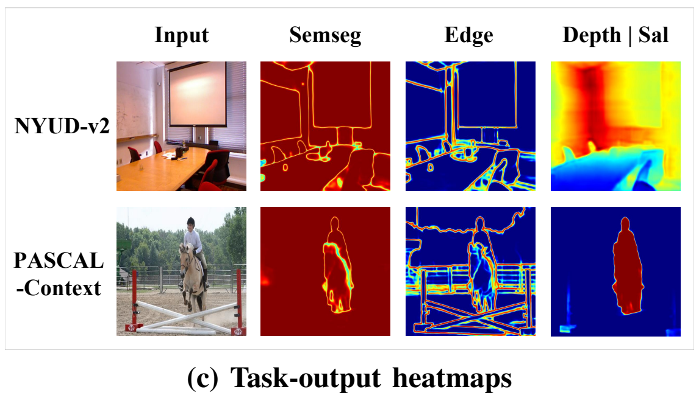
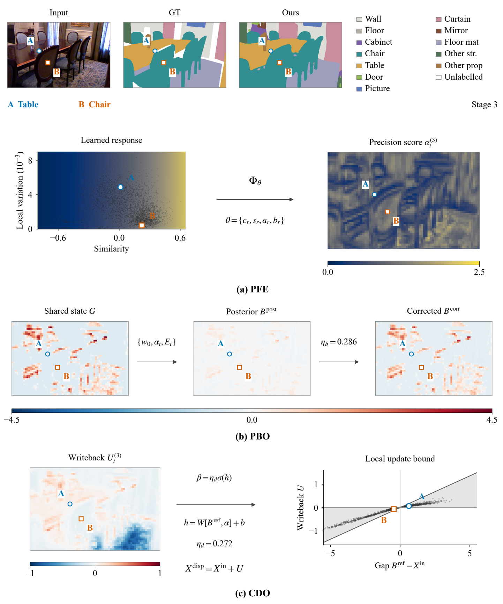

# B³-Net: Controlled Posterior Bridge Learning for Multi-Task Dense Prediction

Meihua Zhou and Li Yang

[Code](https://github.com/mh-zhou/B3Net)

B³-Net combines a Precision Field Estimator (PFE), a Posterior Bridge Operator
(PBO), and a Contractive Dispatch Operator (CDO) for cross-task feature interaction.

<p align="center">
  <a href="figures/overview.png"></a>
</p>

## Training

### Environment and datasets

Use the environment with Python 3.8 and CUDA 11.7:

```bash
conda create -n b3 python=3.8
conda activate b3
pip install torch==1.13.1+cu117 torchvision==0.14.1+cu117 torchaudio==0.13.1 --extra-index-url https://download.pytorch.org/whl/cu117
pip install -r requirements.txt
mim install mmsegmentation==0.30.0 mmcv==1.7.0
cd models/ops_dcnv3
sh make.sh
cd ../..
python -B tests/test_dcnv3.py
```

See [InternImage](https://github.com/OpenGVLab/InternImage/tree/master/segmentation#installation)
for DCNv3 installation. NumPy 1.24.4 is specified for Python 3.8 compatibility.

Download the preprocessed datasets used by BridgeNet, ATRC, and InvPT:

```bash
mkdir -p datasets
cd datasets
wget https://data.vision.ee.ethz.ch/brdavid/atrc/NYUDv2.tar.gz
wget https://data.vision.ee.ethz.ch/brdavid/atrc/PASCALContext.tar.gz
tar xfvz NYUDv2.tar.gz
tar xfvz PASCALContext.tar.gz
cd ..
export B3_DATA_ROOT="$PWD/datasets"
```

`B3_DATA_ROOT` contains `NYUDv2/` and `PASCALContext/`; paths are configured in
[`configs/mypath.py`](configs/mypath.py).

Train InternImage-L on one GPU:

```bash
bash run_nyud.sh
bash run_PASCALContext.sh
```

Validation and checkpoint saving run every 1,000 iterations and at the final
iteration. An existing training checkpoint resumes the run; change `version_name`
for a new run. The paper experiments used NVIDIA A100 GPUs.

### Other backbones

Pass a configuration to select another backbone:

```bash
bash run_nyud.sh configs/nyud/vit_b.yaml
bash run_PASCALContext.sh configs/pascal/vit_l.yaml
```

InternImage backbone weights download automatically. ViT-B requires the pretrained
file named in [`utils/common_config.py`](utils/common_config.py) in the PyTorch
checkpoint cache. W&B logging is disabled by default.

Boundary predictions are saved for ODS-F evaluation with
[SEISM](https://github.com/jponttuset/seism) or the
[boundary evaluation tools](https://github.com/prismformore/Boundary-Detection-Evaluation-Tools).

## Models and results

Paper-reported results for B³-Net. The checkpoints were saved at
the final training iteration and are provided for visualization.

| Dataset | Seg. mIoU | Depth RMSE | Parts mIoU | Sal. maxF | Normal mErr | Edge ODS-F | Checkpoint |
|:---|---:|---:|---:|---:|---:|---:|:---:|
| NYUD-v2 | 57.78 | 0.4587 | — | — | 17.22 | 83.18 | [Download](https://drive.google.com/file/d/1_0z1hJs-7pTbMdXlMSw2Bi2ACajElz7z/view?usp=sharing) |
| PASCAL-Context | 80.81 | — | 73.73 | 86.11 | 13.40 | 81.18 | [Download](https://drive.google.com/file/d/1dJmioAYZ9gkDn_DVhMLUXHkRerb9AeL8/view?usp=sharing) |

## Visualizations

<table align="center">
  <tr>
    <td width="360" align="center">NYUD-v2<br><a href="vis/nyud/qualitative.png"></a></td>
    <td width="360" align="center">PASCAL-Context<br><a href="vis/pascal/qualitative.png"></a></td>
  </tr>
  <tr>
    <td width="360" align="center">Task outputs<br><a href="figures/task_output_maps.png"></a></td>
    <td width="360" align="center">PFE, PBO, CDO<br><a href="figures/operator_mechanisms.png"></a></td>
  </tr>
</table>

## Acknowledgments

Our code builds on [BridgeNet](https://github.com/Evergreen0929/EEMTL/tree/main/BridgeNet),
[InvPT](https://github.com/prismformore/Multi-Task-Transformer/tree/main/InvPT),
[MTI-Net](https://github.com/SimonVandenhende/Multi-Task-Learning-PyTorch),
[ATRC](https://github.com/brdav/atrc), and [InternImage](https://github.com/OpenGVLab/InternImage).
We also thank the [TaskPrompter](https://github.com/prismformore/Multi-Task-Transformer/tree/main/TaskPrompter)
authors for releasing their code.

We sincerely thank the editors and reviewers for their thoughtful guidance and encouragement throughout the peer-review process. We deeply appreciate the time and care they devoted to our work, and their constructive feedback has greatly improved the quality of this manuscript.

## Publication

The paper has not yet been published. The citation and paper PDF will be added to
this repository upon publication. Thank you for your understanding.


